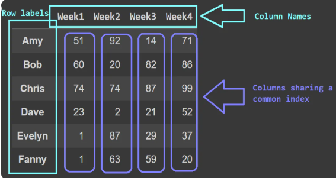
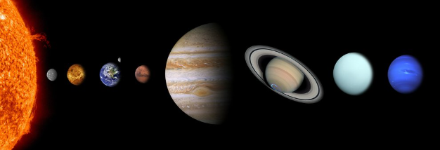
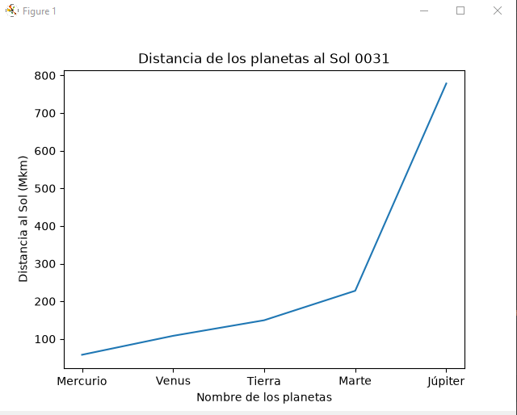
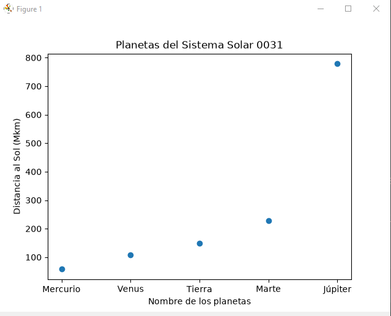
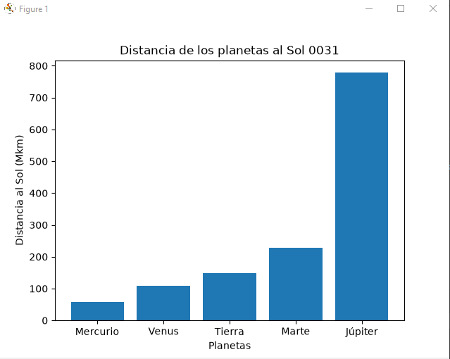
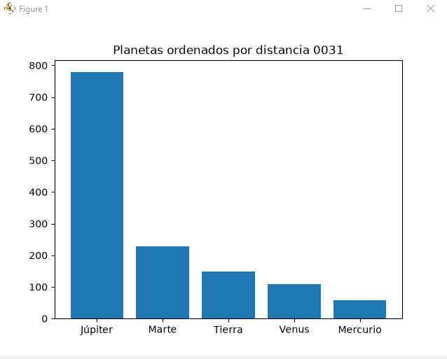
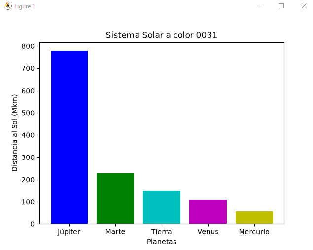
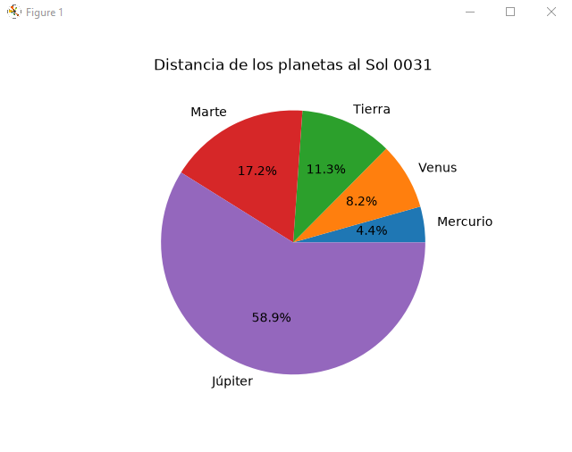

## Dataframe o Marco de datos pandas

## El Sistema solar 

## Grafica lineal del Sistema solar 

## Grafica puntos del Sistema solar 

## Grafica de barras del Sistema solar 

## Grafica de barras del mas grande al chico Descendente

## Coloreando la grafica

## Grafica pastel o pie

